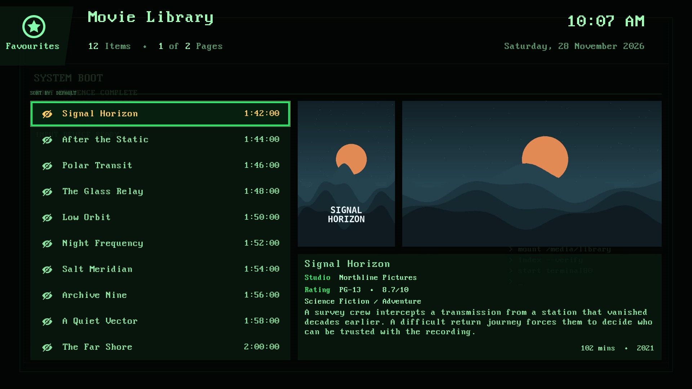

# Terminal 80

Terminal 80 is a dark Kodi skin with VGA text, terminal backgrounds, and phosphor-green, amber, ice-blue, and violet color palettes. Media Info 2 is the default video library view.

## Upstream attribution

Original skin: **Eminence 2.0** by **jurialmunkey**.
Upstream repository: https://github.com/jurialmunkey/skin.eminence.2

The upstream work is licensed under **Creative Commons Attribution-NonCommercial-ShareAlike 3.0 Unported (CC BY-NC-SA 3.0)**. This derivative is distributed under the same license. See `LICENSE.txt` for the upstream license notice and the upstream repository for full attribution and source history.

Terminal 80 visual assets and modifications are provided as a non-commercial derivative. The unmodified PxPlus IBM VGA 9x16 font is from VileR's [Ultimate Oldschool PC Font Pack](https://int10h.org/oldschool-pc-fonts/) and is distributed separately under CC BY-SA 4.0. See [the font license](fonts/OLDSCHOOL-PC-FONTS-LICENSE.txt).
